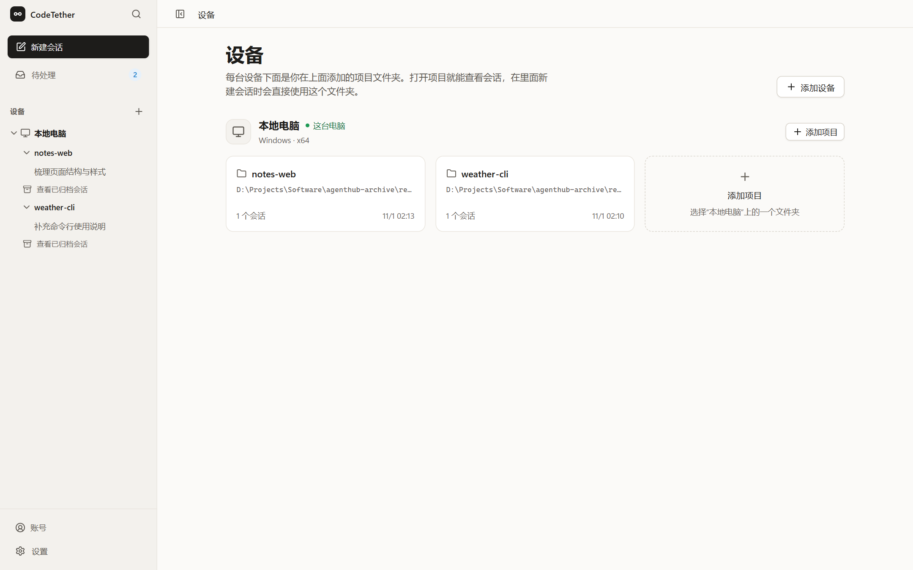
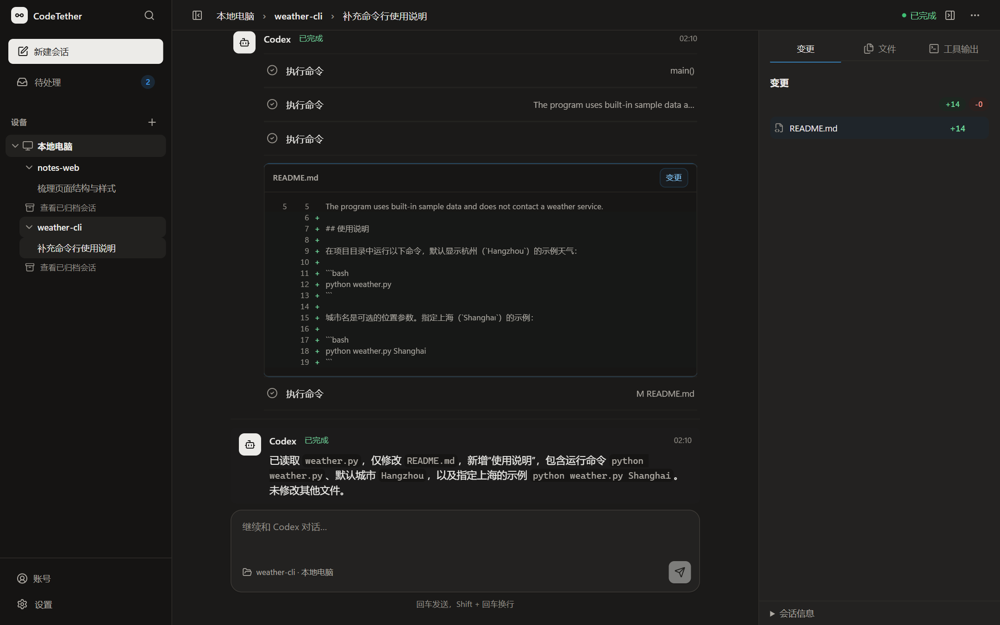

# CodeTether

English | [简体中文](README.zh-CN.md)

View and control Codex and Claude Code conversations across your computers in one place.

> **Early alpha.** No installers are published yet; build from source. The interface is currently available only in Simplified Chinese.



Screenshots are from the development version in browser mode, using demo projects.

## What you can do

Organize your work as **Account › Device › Project › Conversation**.

- **Account:** sign in to an existing account with an email code. Node pairing is independent of account login.
- **Devices:** use this computer and devices explicitly paired through CodeTether Node. Node build targets are Linux x64 / arm64 and macOS arm64. Windows computers can currently be used only as “this computer.”
- **Projects:** add a folder on a device. CodeTether automatically discovers previous Codex and Claude Code conversations in that folder; select which ones to import and continue.
- **Conversations:** create, send messages, pin, rename, and archive. Search within a project by conversation title and messages you have sent.
- **Codex on this computer:** stop a running turn, choose Allow Once or Decline for an approval, and inspect file changes. These controls are unavailable for conversations on paired devices.
- **Claude Code:** read and search files. File editing, shell commands, stop, and approval controls are unavailable.
- **Attention:** review requests for approval, completed work, and failures in one queue, with desktop system notifications.
- **Appearance and navigation:** light, dark, and system themes; a command palette with Ctrl K (⌘K on macOS) for navigation, loaded conversation titles, and common actions.



_A Codex conversation with line-by-line README changes and the Changes panel._

## Platforms

All entries below require source builds. A build target does not imply a published installer or completed platform validation.

| Component       | System                      | Current status                                                                                                 |
| --------------- | --------------------------- | -------------------------------------------------------------------------------------------------------------- |
| Desktop app     | Windows x64                 | Available from source; early alpha                                                                             |
| Desktop app     | macOS arm64 (Apple Silicon) | Build from source; validation in progress                                                                      |
| Desktop app     | Linux x64                   | Build target; outside the current supported desktop matrix                                                     |
| CodeTether Node | Linux x64                   | Build target; physical support has not been confirmed in the support documentation                             |
| CodeTether Node | Linux arm64                 | Device pairing; Raspberry Pi 5 validation is documented, while tool execution depends on detected capabilities |
| CodeTether Node | macOS arm64 (Apple Silicon) | Device pairing; tool execution depends on detected capabilities                                                |
| CodeTether Node | Windows                     | Unavailable; use the desktop app as “this computer”                                                            |

## Not available yet

- Phone and tablet apps.
- Adding other computers signed in to the same account as devices.
- Pairing a Windows computer as a device.
- One-click updates.
- Published installers.

These are future work; no delivery dates are promised.

## Build from source

Use Node.js **25.5+** for the desktop sidecar and the pnpm version recorded in `package.json` (currently **11.20.0**). You also need Rust **1.85+** and the native build prerequisites for your platform. On Windows, these include the MSVC target, C++ Build Tools, Windows SDK, and WebView2. Install and sign in to the Codex or Claude Code CLI you intend to use.

Desktop builds currently require an account service. Instructions for self-hosting the account service are not yet available.

Configure the three required variables: `VITE_CODETETHER_CONTROL_PLANE_URL`, `VITE_SUPABASE_URL`, and `VITE_SUPABASE_PUBLISHABLE_KEY`. The desktop build validates all three. `VITE_CODETETHER_HOST_URL` is optional and has a local default. See the [development guide](docs/DEVELOPMENT.md) for configuration details, then run from the repository root:

```bash
pnpm install --frozen-lockfile
pnpm desktop:build
```

See the [development guide](docs/DEVELOPMENT.md) for configuration, platform prerequisites, development commands, and local data locations.

## Privacy and security

The local Host HTTP API listens only on `127.0.0.1` and checks the request Host and an explicit Origin allowlist. Connections to Node devices use explicit pairing, identity confirmation, and authenticated TLS with pinned peer identities.

Project folders are authorized through the Host, and their paths are checked again before starting or resuming work. Account services and cross-device connections have separate roles; see the [architecture](docs/ARCHITECTURE.md) for the trust boundaries and limitations.

## License

CodeTether is **source-available** under [FSL-1.1-ALv2](LICENSE). You may read and modify the source, use it internally, and use it for non-commercial education and research. You may not offer it as a competing commercial product or service. Each version becomes available under Apache 2.0 two years after its release.

See the full [license](LICENSE) and [Functional Source License website](https://fsl.software/) for the terms.
