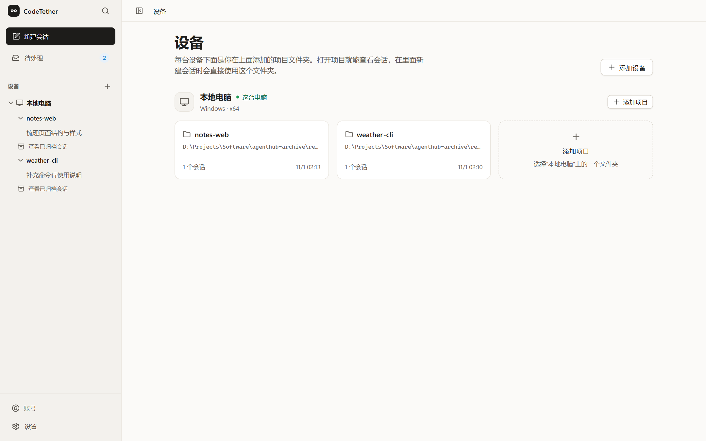
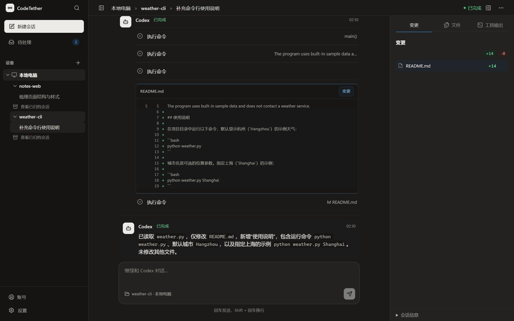

# CodeTether

[English](README.md) | 简体中文

在一个地方查看和控制多台电脑上的 Codex 和 Claude Code 会话。

> **早期 alpha。** 目前没有发布安装包，需要从源码构建。界面目前只有简体中文。



截图来自浏览器模式下的开发版本，使用演示项目。

## 它能做什么

按 **账号 › 设备 › 项目 › 会话** 组织工作。

- **账号：** 用邮箱登录码登录已有账号。Node 配对与账号登录相互独立。
- **设备：** 使用这台电脑，以及通过 CodeTether Node 明确配对的设备。Node 的构建目标为 Linux x64 / arm64 和 macOS arm64。Windows 电脑目前只能作为“这台电脑”。
- **项目：** 添加设备上的一个文件夹，CodeTether 会自动找出这个文件夹里以前的 Codex 和 Claude Code 会话，由你选择导入后继续。
- **会话：** 新建、发送消息、置顶、重命名和归档。可以在项目内搜索会话标题和你发送过的内容。
- **这台电脑上的 Codex：** 停止正在运行的回合，为批准请求选择“允许一次”或“拒绝”，查看文件变更。配对设备上的会话不提供这些操作。
- **Claude Code：** 读取和搜索文件。目前没有文件编辑、Shell 命令、停止和批准功能。
- **待处理：** 集中查看需要批准、已完成和失败三类事项，并接收桌面系统通知。
- **外观与导航：** 浅色、深色和跟随系统主题；按 Ctrl K（macOS 上为 ⌘K）打开命令面板，跳转页面、查找已读取的会话标题或使用常用操作。



_Codex 会话中的 README 逐行差异与右侧变更面板。_

## 支持的平台

下表均需从源码构建。有构建目标不代表已经发布安装包或完成平台验证。

| 组件            | 系统                         | 当前状态                                                                    |
| --------------- | ---------------------------- | --------------------------------------------------------------------------- |
| 桌面应用        | Windows x64                  | 可从源码构建，早期 alpha                                                    |
| 桌面应用        | macOS arm64（Apple Silicon） | 从源码构建，验收中                                                          |
| 桌面应用        | Linux x64                    | 有构建目标，当前桌面支持范围不包含此平台                                    |
| CodeTether Node | Linux x64                    | 有构建目标，支持文档尚未确认实机支持                                        |
| CodeTether Node | Linux arm64                  | 可配对设备；已有 Raspberry Pi 5 验证记录，AI 工具能否执行取决于检测到的能力 |
| CodeTether Node | macOS arm64（Apple Silicon） | 可配对设备，AI 工具能否执行取决于检测到的能力                               |
| CodeTether Node | Windows                      | 暂不提供，请使用桌面应用作为“这台电脑”                                      |

## 还没有的功能

- 手机和平板应用。
- 将同一账号下的其他电脑添加为设备。
- 将 Windows 电脑作为配对设备。
- 一键更新。
- 安装包发布。

这些属于后续工作，目前不承诺时间。

## 从源码构建

桌面 sidecar 构建需要 Node.js **25.5+**，pnpm 使用 `package.json` 记录的版本，目前为 **11.20.0**。还需要 Rust **1.85+** 和对应平台的原生构建依赖。Windows 需要 MSVC 目标、C++ Build Tools、Windows SDK 和 WebView2。请安装并登录你要使用的 Codex 或 Claude Code CLI。

桌面构建目前需要一个账号服务，暂时没有自建账号服务的说明。

`VITE_CODETETHER_CONTROL_PLANE_URL`、`VITE_SUPABASE_URL` 和 `VITE_SUPABASE_PUBLISHABLE_KEY` 三项必填，桌面构建会校验；`VITE_CODETETHER_HOST_URL` 可选，有本机默认值。先按[开发说明](docs/DEVELOPMENT.md)配置，再在仓库根目录运行：

```bash
pnpm install --frozen-lockfile
pnpm desktop:build
```

配置、各平台前置条件、开发命令和本地数据目录见[开发说明](docs/DEVELOPMENT.md)。

## 隐私和安全

Host 的本地 HTTP API 只监听 `127.0.0.1`，并检查请求 Host 和明确列出的 Origin 白名单。连接 Node 设备需要主动配对、核对身份，并通过固定对端身份的 TLS 进行认证和加密。

项目文件夹由 Host 授权，开始或恢复工作前会再次检查路径。账号服务与跨设备连接各有独立职责，信任边界和限制见[架构说明](docs/ARCHITECTURE.md)。

## 许可证

CodeTether 采用 [FSL-1.1-ALv2](LICENSE)，属于**源码可见**软件。你可以阅读和修改源码、内部使用，以及用于非商业教育和研究；不允许将其作为与 CodeTether 竞争的商业产品或服务提供给他人。每个版本发布满两年后转为 Apache 2.0。

完整条款见 [LICENSE](LICENSE) 和 [Functional Source License 网站](https://fsl.software/)。
